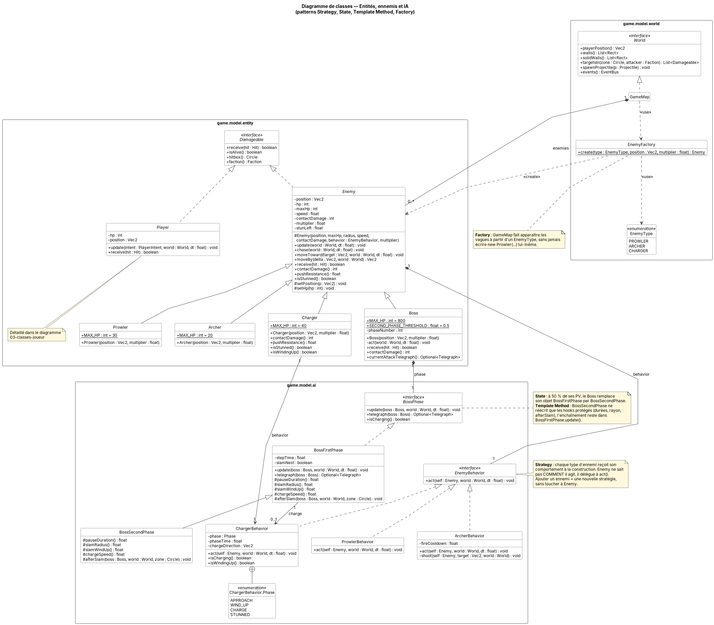
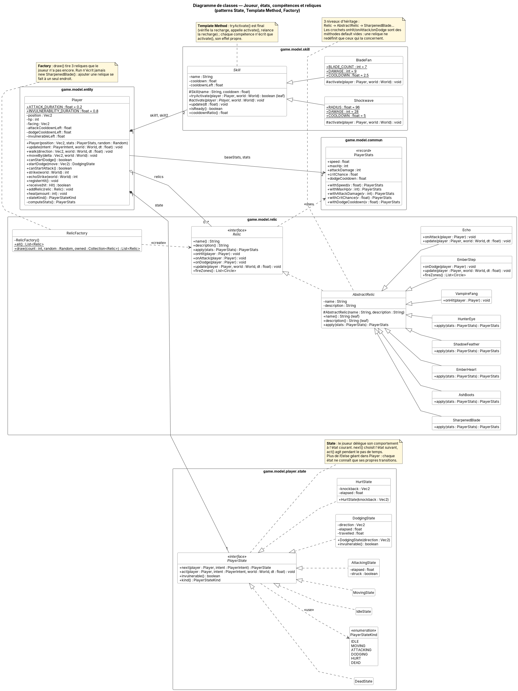

# Architecture technique — Kagaribi

Organisation interne du jeu et design patterns utilisés. Les diagrammes UML sont dans
[`docs/uml/`](uml/) (source PlantUML `.puml` + image `.png`). Le contenu du jeu (règles,
ennemis, reliques) est décrit dans le [GDD](GDD.md).

| Diagramme | Type UML |
|---|---|
| [`01-cas-utilisation`](uml/01-cas-utilisation.png) | Cas d'utilisation |
| [`02-classes-entites-ia`](uml/02-classes-entites-ia.png) | Classes : entités, ennemis, IA, boss |
| [`03-classes-joueur`](uml/03-classes-joueur.png) | Classes : joueur, états, compétences, reliques |

## 1. Trois modules

| Module | Rôle | Dépend de |
|---|---|---|
| `model` | Toutes les règles du jeu, en Java pur | rien |
| `core` | Écrans, rendu, HUD, son, entrées clavier / souris / manette | `model`, libGDX |
| `lwjgl3` | Lanceur desktop | `core` |

`model` ne déclare aucune dépendance vers libGDX : un `import com.badlogic…` n'y compile pas.
La séparation modèle / vue est donc garantie par le build, et le modèle se teste sans fenêtre.
La vue envoie au modèle une intention (`PlayerIntent`) et lit son état pour dessiner ; elle ne
décide jamais d'une règle.

## 2. Boucle de jeu

À chaque image, `GameScreen.render(delta)` lit les entrées (`PlayerIntent`), fait avancer le
modèle par pas fixes de 1/60 s (`FixedStep`), puis dessine. Pendant un pas, `Run` fait avancer
`GameMap` (joueur, ennemis, projectiles, vagues), puis distribue les événements du pas
(`EventBus.flush()`).

## 3. Design patterns

**State — états du joueur** ([02](uml/02-classes-entites-ia.png), [03](uml/03-classes-joueur.png)).
`Player` délègue son comportement à un `PlayerState` : `IdleState`, `MovingState`,
`AttackingState`, `DodgingState`, `HurtState`, `DeadState`. Chaque état décide de l'état
suivant (`next()`) et agit (`act()`). Sans ça : un gros `switch` dans `Player`, à modifier à
chaque nouvel état. Même principe pour le boss : à 50 % de ses PV, `Boss` remplace son
`BossFirstPhase` par un `BossSecondPhase`.

**Strategy — IA des ennemis** ([02](uml/02-classes-entites-ia.png)).
Chaque ennemi reçoit un `EnemyBehavior` à la construction (`ProwlerBehavior`,
`ArcherBehavior`, `ChargerBehavior`). `Enemy` gère le commun (PV, recul, collisions) et délègue
la décision à `act()`. Ajouter un ennemi = écrire une stratégie, sans toucher à `Enemy`. La
charge du boss réutilise `ChargerBehavior` au lieu de la recopier.

**Template Method — compétences, phases du boss** ([02](uml/02-classes-entites-ia.png), [03](uml/03-classes-joueur.png)).
`Skill.tryActivate()` est `final` : elle vérifie la recharge, appelle `activate()` (abstraite)
puis relance la recharge ; `Shockwave` et `BladeFan` n'écrivent que `activate()`.
`BossSecondPhase` hérite de `BossFirstPhase` et ne redéfinit que des méthodes protégées
(durées, rayon, `afterSlam()`). Même chose pour les menus : `MenuScreen.render()` est `final`
et appelle `handleInput()` et `drawContent()`. Et pour la manette : `Gamepad.update()` est
`final` (zone morte, appuis, directions des menus) ; `GlfwGamepad`, dans le module `lwjgl3`, ne
fournit que la lecture brute du matériel, donc `core` ne dépend d'aucune bibliothèque de manette.

**Command — intentions du joueur.**
Le clavier, la manette et les tests produisent tous un `PlayerIntent` (déplacement, visée,
boutons maintenus) : le modèle ne sait jamais quelle touche a été pressée. Chaque source
d'entrées implémente `InputSource` (`KeyboardMouseInput`, `GamepadInput`) ; `CombinedInput` les
réunit pour jouer avec les deux à la fois.

**Factory — reliques et ennemis** ([02](uml/02-classes-entites-ia.png), [03](uml/03-classes-joueur.png)).
`RelicFactory.draw(3, …)` tire 3 reliques que le joueur n'a pas encore ; `EnemyFactory.create()`
transforme un `EnemyType` (donnée d'une vague) en `Enemy`. `Run` et `GameMap` n'écrivent
jamais `new SharpenedBlade()` ou `new Prowler()` : ajouter une relique ou un ennemi se fait à
un seul endroit.

**Observer — bus d'événements.**
Le modèle publie des `GameEvent` (`EntityHit`, `EntityDied`, `StageCleared`…) dans un
`EventBus`. Les abonnés réagissent sans que l'émetteur les connaisse : `Run` et `Experience`
dans le modèle, le son, les chiffres de dégâts et la fumée dans la vue. Le modèle ne dépend
jamais de la vue.

**Game Loop à pas fixe.**
`FixedStep.advance(delta)` convertit le temps réel en pas de 1/60 s (5 au plus par image). La
simulation donne le même résultat quelle que soit la fréquence de l'écran : avec la graine
aléatoire de la partie, le jeu est déterministe et testable pas à pas.

## 4. Tests

`./scripts/run_tests.sh` lance les tests du modèle (JUnit 5) et affiche la couverture
(JaCoCo, rapport dans `model/build/reports/jacoco/test/html/index.html`). Les tests des entrées
manette sont dans `core` (`./gradlew core:test`). La Javadoc se génère avec `./gradlew javadoc`.
