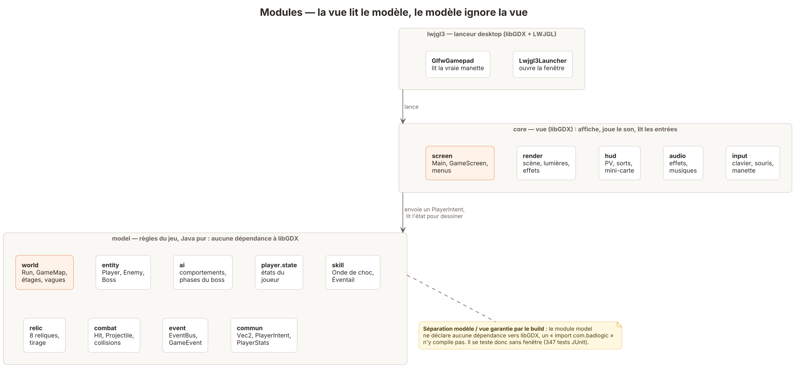
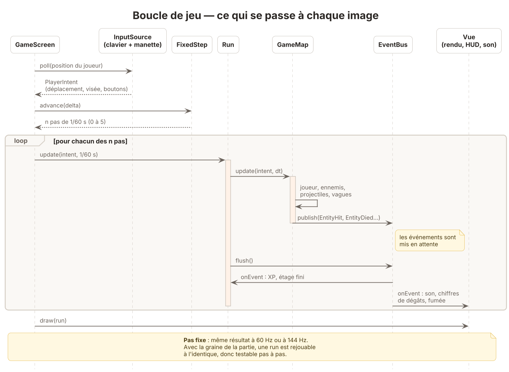
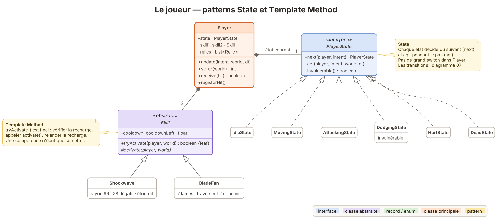
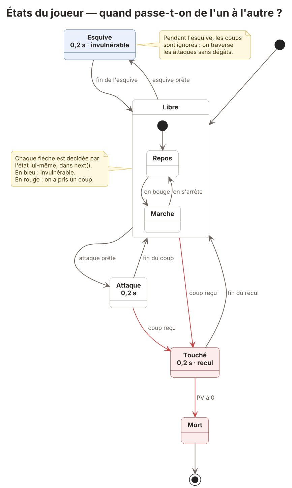
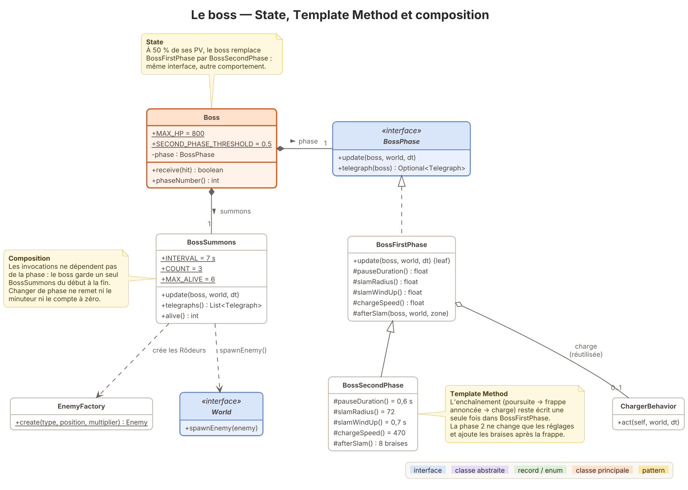
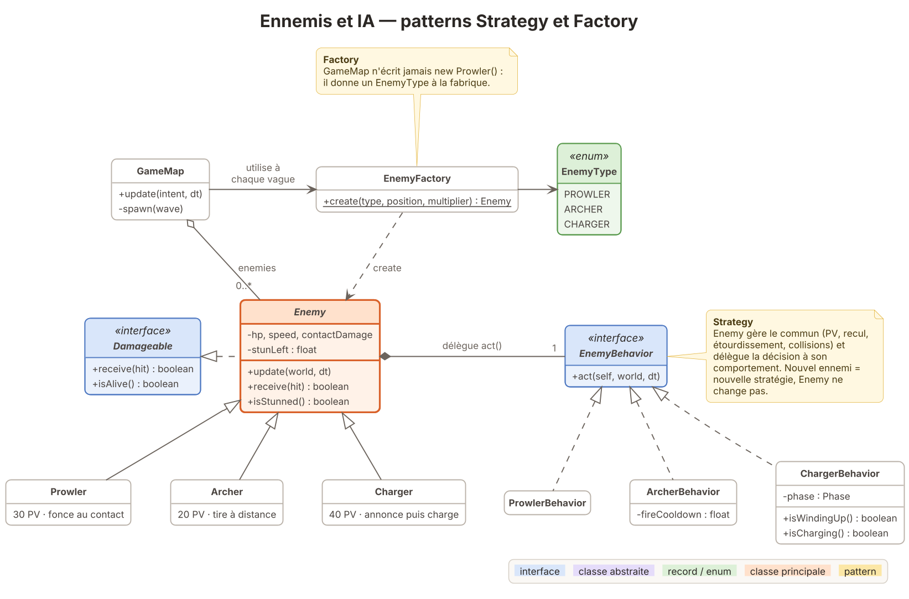
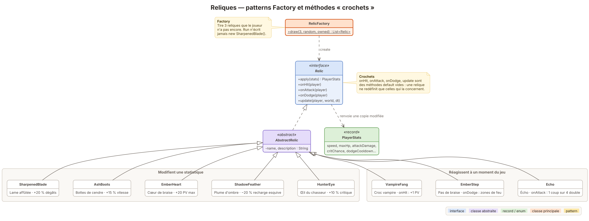
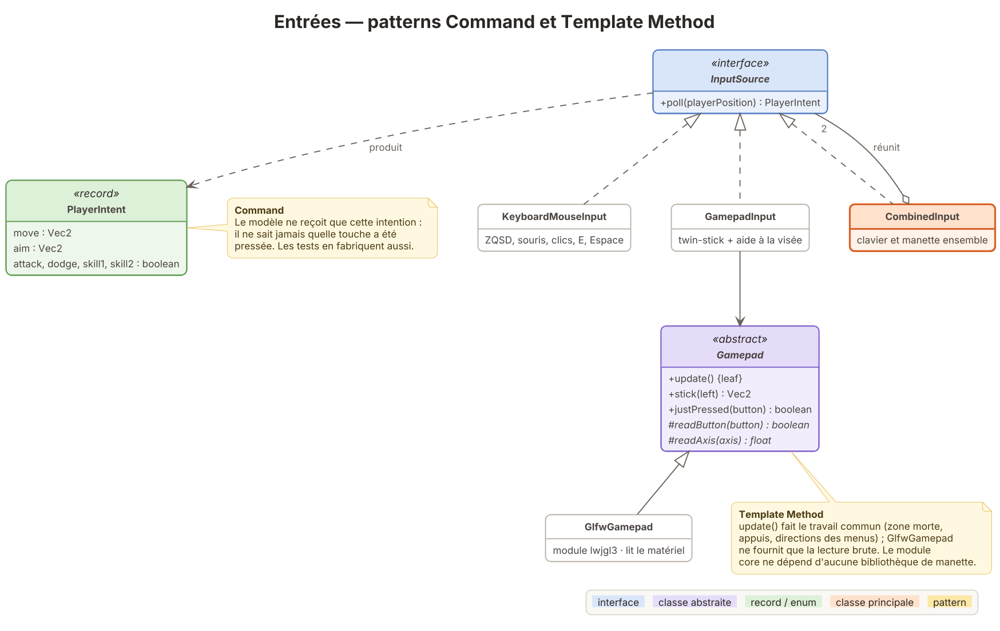
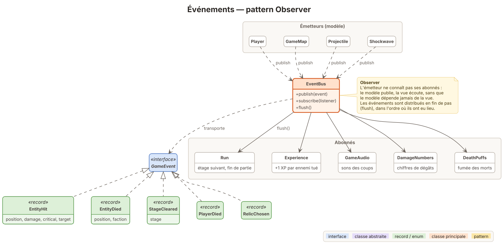

# Architecture technique — Kagaribi

Organisation interne du jeu et design patterns utilisés. Le contenu du jeu (règles, ennemis,
reliques) est décrit dans le [GDD](GDD.docx).

## Diagrammes UML

Dix diagrammes courts, chacun pour une seule idée. Sources PlantUML (`.puml`) et images
(`.png` pour la lecture, `.svg` pour zoomer sans flou) dans [`docs/uml/`](uml/).

| # | Diagramme | Type UML | Ce qu'il montre |
|---|---|---|---|
| 01 | [Cas d'utilisation](uml/01-cas-utilisation.png) | Cas d'utilisation | Ce que le joueur peut faire |
| 02 | [Modules](uml/02-modules.png) | Paquetages | Les 3 modules et la séparation modèle / vue |
| 03 | [Boucle de jeu](uml/03-boucle-de-jeu.png) | Séquence | Ce qui se passe à chaque image |
| 04 | [Ennemis et IA](uml/04-ennemis-ia.png) | Classes | Strategy, Factory |
| 05 | [Boss](uml/05-boss.png) | Classes | State, Template Method, composition |
| 06 | [Joueur](uml/06-joueur.png) | Classes | State, Template Method |
| 07 | [États du joueur](uml/07-etats-joueur.png) | États-transitions | Quand le joueur change d'état |
| 08 | [Reliques](uml/08-reliques.png) | Classes | Factory, méthodes « crochets » |
| 09 | [Entrées](uml/09-entrees.png) | Classes | Command, Template Method |
| 10 | [Événements](uml/10-evenements.png) | Classes | Observer |

**Code couleur, le même partout** : bleu = interface, violet = classe abstraite, vert = record
ou enum (données), orange = la classe au centre du diagramme, encadré jaune = le pattern
illustré. Les diagrammes ne montrent que les membres utiles à la compréhension : les
accesseurs et le détail des calculs sont dans la Javadoc.

## 1. Trois modules



| Module | Rôle | Dépend de |
|---|---|---|
| `model` | Toutes les règles du jeu, en Java pur | rien |
| `core` | Écrans, rendu, HUD, son, entrées clavier / souris / manette | `model`, libGDX |
| `lwjgl3` | Lanceur desktop | `core` |

`model` ne déclare aucune dépendance vers libGDX : un `import com.badlogic…` n'y compile pas.
La séparation modèle / vue est donc garantie par le build, et le modèle se teste sans fenêtre.
La vue envoie au modèle une intention (`PlayerIntent`) et lit son état pour dessiner ; elle ne
décide jamais d'une règle.

## 2. Boucle de jeu



À chaque image, `GameScreen.render(delta)` lit les entrées (`PlayerIntent`), fait avancer le
modèle par pas fixes de 1/60 s (`FixedStep`), puis dessine. Pendant un pas, `Run` fait avancer
`GameMap` (joueur, ennemis, projectiles, vagues), puis distribue les événements du pas
(`EventBus.flush()`).

**Game Loop à pas fixe.**
`FixedStep.advance(delta)` convertit le temps réel en pas de 1/60 s (5 au plus par image). La
simulation donne le même résultat quelle que soit la fréquence de l'écran : avec la graine
aléatoire de la partie, le jeu est déterministe et testable pas à pas.

## 3. Design patterns

### State — états du joueur et phases du boss



`Player` délègue son comportement à un `PlayerState` : `IdleState`, `MovingState`,
`AttackingState`, `DodgingState`, `HurtState`, `DeadState`. Chaque état décide de l'état
suivant (`next()`) et agit (`act()`). Sans ça : un gros `switch` dans `Player`, à modifier à
chaque nouvel état. Les transitions sont sur le diagramme d'états :



Même principe pour le boss : à 50 % de ses PV, `Boss` remplace son `BossFirstPhase` par un
`BossSecondPhase`. Ses invocations, elles, ne dépendent pas de la phase : elles vivent dans un
objet à part, `BossSummons`, que le boss garde du début à la fin du combat (composition). Changer
de phase ne remet donc ni le minuteur ni le compte des Rôdeurs à zéro.



### Strategy — IA des ennemis



Chaque ennemi reçoit un `EnemyBehavior` à la construction (`ProwlerBehavior`,
`ArcherBehavior`, `ChargerBehavior`). `Enemy` gère le commun (PV, recul, étourdissement,
collisions) et délègue la décision à `act()`. Ajouter un ennemi = écrire une stratégie, sans
toucher à `Enemy`. La charge du boss réutilise `ChargerBehavior` au lieu de la recopier.

### Template Method — compétences, phases du boss, menus, manette

`Skill.tryActivate()` est `final` : elle vérifie la recharge, appelle `activate()` (abstraite)
puis relance la recharge ; `Shockwave` et `BladeFan` n'écrivent que `activate()`
([06](uml/06-joueur.png)). `BossSecondPhase` hérite de `BossFirstPhase` et ne redéfinit que des
méthodes protégées (durées, rayon, `afterSlam()`) ([05](uml/05-boss.png)). Même chose pour les
menus : `MenuScreen.render()` est `final` et appelle `handleInput()` et `drawContent()`. Et pour
la manette : `Gamepad.update()` est `final` (zone morte, appuis, directions des menus) ;
`GlfwGamepad`, dans le module `lwjgl3`, ne fournit que la lecture brute du matériel, donc `core`
ne dépend d'aucune bibliothèque de manette ([09](uml/09-entrees.png)).

### Factory — reliques et ennemis



`RelicFactory.draw(3, …)` tire 3 reliques que le joueur n'a pas encore ; `EnemyFactory.create()`
transforme un `EnemyType` (donnée d'une vague) en `Enemy` ([04](uml/04-ennemis-ia.png)). `Run`
et `GameMap` n'écrivent jamais `new SharpenedBlade()` ou `new Prowler()` : ajouter une relique
ou un ennemi se fait à un seul endroit. Les moments où une relique réagit (`onHit`,
`onAttack`, `onDodge`, `update`) sont des méthodes `default` vides : chaque relique ne
redéfinit que celles qui la concernent.

### Command — intentions du joueur



Le clavier, la manette et les tests produisent tous un `PlayerIntent` (déplacement, visée,
boutons maintenus) : le modèle ne sait jamais quelle touche a été pressée. Chaque source
d'entrées implémente `InputSource` (`KeyboardMouseInput`, `GamepadInput`) ; `CombinedInput` les
réunit pour jouer avec les deux à la fois.

### Observer — bus d'événements



Le modèle publie des `GameEvent` (`EntityHit`, `EntityDied`, `StageCleared`…) dans un
`EventBus`. Les abonnés réagissent sans que l'émetteur les connaisse : `Run` et `Experience`
dans le modèle, le son, les chiffres de dégâts et la fumée dans la vue. Le modèle ne dépend
jamais de la vue.

## 4. Notions orientées objet : où les trouver

| Notion | Dans le code |
|---|---|
| **Interfaces** (un contrat, sans état) | [`World`](../model/src/main/java/game/model/world/World.java), [`Damageable`](../model/src/main/java/game/model/entity/Damageable.java), [`PlayerState`](../model/src/main/java/game/model/player/state/PlayerState.java), [`EnemyBehavior`](../model/src/main/java/game/model/ai/EnemyBehavior.java), [`BossPhase`](../model/src/main/java/game/model/ai/BossPhase.java), [`Relic`](../model/src/main/java/game/model/relic/Relic.java), [`InputSource`](../core/src/main/java/game/core/input/InputSource.java), et [`GameEvent`](../model/src/main/java/game/model/event/GameEvent.java), interface scellée : seuls ses 5 records peuvent l'implémenter |
| **Classes abstraites** (un état et un comportement communs) | [`Enemy`](../model/src/main/java/game/model/entity/Enemy.java) (PV, recul, collisions), [`Skill`](../model/src/main/java/game/model/skill/Skill.java) (recharge), [`AbstractRelic`](../model/src/main/java/game/model/relic/AbstractRelic.java) (nom, description), [`Gamepad`](../core/src/main/java/game/core/input/Gamepad.java) (zone morte, appuis), [`MenuScreen`](../core/src/main/java/game/core/screen/MenuScreen.java) et [`EndScreen`](../core/src/main/java/game/core/screen/EndScreen.java) (écrans) |
| **Héritage** | `Prowler`, `Archer`, `Charger` et `Boss` héritent d'`Enemy` ; trois niveaux dans notre propre code : `VictoryScreen` → `EndScreen` → `MenuScreen` ; `Relic` → `AbstractRelic` → `SharpenedBlade` |
| **Polymorphisme** | `Player` appelle `state.act()` sans savoir dans quel état il est ; `Enemy` appelle `behavior.act()` sans savoir quel ennemi il est |
| **Redéfinition** | `Shockwave` et `BladeFan` redéfinissent `activate()` de `Skill` ; `BossSecondPhase` redéfinit les réglages de `BossFirstPhase` |
| **Surcharge** | [`Gamepad.justPressed(Button)`](../core/src/main/java/game/core/input/Gamepad.java) et `justPressed(Direction)` ; trois constructeurs de [`Projectile`](../model/src/main/java/game/model/combat/Projectile.java) |
| **Encapsulation** | Aucun attribut public modifiable dans le projet : l'état ne change que par une méthode qui applique une règle (par exemple `Player.receive(Hit)` vérifie l'invincibilité) |
| **Objets immuables** | 21 records, dont `Vec2`, `Hit`, `PlayerIntent`, `PlayerStats` et `Wave` : un vecteur ou un coup partagé ne peut pas être modifié par erreur |

## 5. Tests

`./scripts/run_tests.sh` lance tous les tests (JUnit 6) : les règles du jeu dans `model`, les
entrées manette et l'aide à la visée dans `core`. Il affiche ensuite la couverture du modèle
(JaCoCo, rapport dans `model/build/reports/jacoco/test/html/index.html`). Le hook versionné
`.githooks/pre-push` lance ce script avant chaque push et bloque le push si un test échoue
(activation : `git config core.hooksPath .githooks`). La Javadoc se génère avec `./gradlew javadoc`.

## 6. Régénérer les diagrammes

Depuis `docs/uml/` (PlantUML et Graphviz installés, police Inter) :

```bash
plantuml -tpng *.puml && plantuml -tsvg *.puml
```
